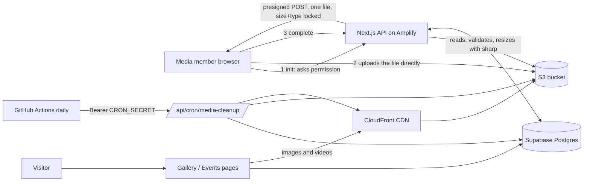

# Media Portal — architecture, deployment and runbook

Media-team members upload event photos and videos; the public sees them on the
Gallery, Events page and landing page. Super admins manage the accounts.

## 1. The big picture

Files never pass through our server on upload (large videos would time out),
and the browser is never trusted: `complete` re-checks size, type and the real
file bytes before anything becomes visible.

## 2. Lifecycle of one item

`pending → processing → ready ↔ hidden`, and `failed` (terminal). Status moves
are always conditional updates (`WHERE id AND status = expected`), so a slow
request cannot overwrite a newer state. Delete is a soft delete (`deleted_at`).

| Stage | Who | What happens |
|---|---|---|
| init | member | row created `pending`; presigned POST (exact size/type) returned |
| upload | browser | file goes to `events/{event}/original/{id}.jpg` (private) or `video/` |
| complete | server | verify file → images: rotate, strip metadata, make 1920px web + 480px thumb WebP → `ready` |
| moderate | uploader / admin | hide ↔ show, caption, soft delete |
| cleanup | daily job | see section 5 |

Special cases: iPhone HEIC is converted to JPEG in the browser; videos are
served as uploaded (MP4/WebM); Google Drive links create `source='drive'` rows
that never touch S3 (see `docs/media-drive-import.md`).

## 3. Security model (short)

- Keys are built from two UUIDs and an allowlisted extension, never from user input. `original/` is never publicly readable.
- Roles come from database tables, never from user-editable metadata. Every API route authorizes on the server; middleware only checks "signed in".
- Members can manage only their own uploads; super admins everything.
- New/reset accounts must change their password before anything else (enforced server-side on every request) — `docs/media-accounts.md`.
- No AWS keys anywhere: Amplify's IAM role supplies credentials (`infra/media-storage.yaml`).
- The public site reads an explicit column allowlist, so internal columns never leak.
- **Limit worth knowing:** hiding or deleting an item removes it from the site immediately, but a copy already cached by CloudFront (up to a year) or saved by a visitor can persist. The cleanup job invalidates the CDN when it purges; for an urgent takedown also run a manual invalidation (section 6).

## 4. Environment variables

| Variable | Required | Where it comes from |
|---|---|---|
| `NEXT_PUBLIC_SUPABASE_URL`, `NEXT_PUBLIC_SUPABASE_PUBLISHABLE_KEY` | yes | Supabase |
| `SUPABASE_SECRET_KEY` | yes | Supabase service key (server only) |
| `S3_BUCKET`, `S3_REGION`, `MEDIA_CDN_URL` | yes | CloudFormation outputs |
| `GOOGLE_DRIVE_API_KEY` | for Drive import | Google Cloud, restricted to Drive API |
| `CRON_SECRET` | for cleanup | `openssl rand -hex 32` (min 32 chars) |
| `MEDIA_CDN_DISTRIBUTION_ID` | recommended | CloudFormation output `DistributionId` |

## 5. Cleanup job

`POST /api/cron/media-cleanup` with `Authorization: Bearer $CRON_SECRET`. Off
(404) when `CRON_SECRET` is unset or under 32 characters. Options: `?dryRun=1`, `?limit=N`.

| Row | Age | Action |
|---|---|---|
| pending (upload never finished) | 24 h | → failed, file deleted |
| processing (stuck) | 24 h | → failed, file deleted |
| failed | 7 d | files + row removed |
| soft-deleted | 7 d | files + row removed, CDN invalidated |

Rules: files are deleted **before** the row (a failed file delete keeps the row
for the next run); only keys that parse as ours *and* match the row's own
event and media id are ever deleted; every change is conditional; each run is
bounded; running it twice is harmless. Thresholds are constants at the top of
`lib/media/cleanup.ts`.

Scheduling: `.github/workflows/media-cleanup.yml` (daily 03:00 IST; secrets
`SITE_URL`, `CRON_SECRET`; "Run workflow" defaults to dry run). Alternative:
an EventBridge Scheduler HTTP target sending the same header.

## 6. Deploy checklist

1. Deploy `infra/media-storage.yaml` (see `infra/README.md`); copy the outputs.
2. Run the migrations in `supabase/migrations/` in order.
3. Set the env vars in section 4 on Amplify; attach the managed policy to the Amplify role.
4. Add `SITE_URL` and `CRON_SECRET` as GitHub secrets.
5. Create the first media member (Admin → Media members), sign in, change password, upload a test photo and a test video.
6. Trigger the workflow once with dry run on, read the response, then once for real.
7. Check `GET /api/admin/media-health` (super admin): no warnings.

## 7. Runbook

| Symptom | Look at | Fix |
|---|---|---|
| "Media uploads are not configured" | `/api/admin/media-health` → `config.storage` | set the named env var, redeploy |
| Items stuck `pending` | health `stalePending` | member re-uploads; cleanup removes the husk within a day |
| Items `failed` | server logs (`[media]` lines) | usually a corrupt file or an IAM change; member re-uploads |
| Cleanup returns 404 | `CRON_SECRET` unset/short | set it (≥ 32 chars) |
| Cleanup returns 401 | secret mismatch | make the GitHub and Amplify values equal |
| `retryLater` > 0 in the report | IAM `s3:DeleteObject` / S3 outage | fix permission; next run completes |
| Urgent takedown | — | delete the item in the portal, then CloudFront → Invalidations → `/events/<event>/*` |
| Photo shows stale after replace | CDN cache | keys are unique per item, so this should not happen; invalidate the path |

## 8. Where the code lives

`lib/media/*` pure rules + ports (status, keys, policy, complete, cleanup, public-view, drive),
`lib/storage/*` S3, `lib/auth/*` roles / passwords / cron auth,
`app/api/media/*` member API, `app/api/admin/*` admin API, `app/api/cron/*` scheduler,
`components/features/media|gallery/*` UI, `tests/*` unit tests (run `npm test`).
